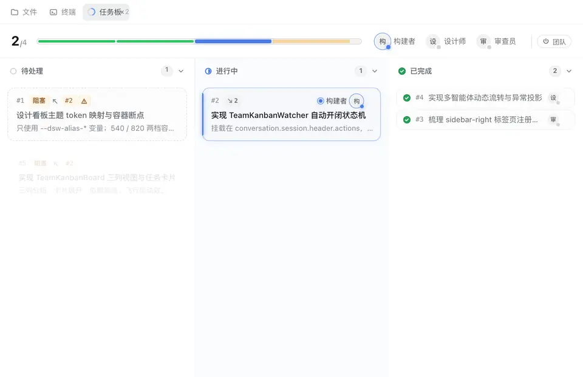
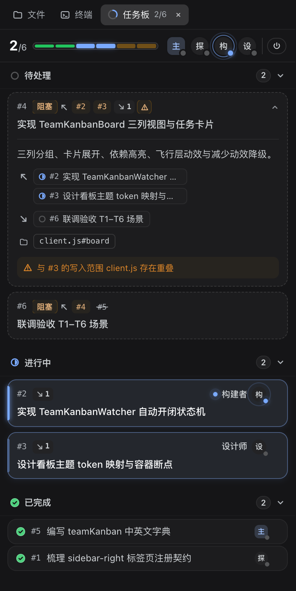
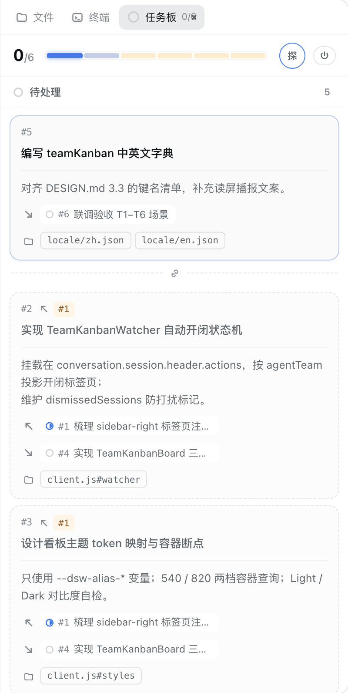

# 📋 dsh-team-kanban

> **给 DeepSeek Harness 的多智能体团队，在右侧栏放一块会呼吸的活体任务看板。**
>
> Native three-column agent-team kanban for [DeepSeek Harness](https://github.com/deepseek-ai/deepseek-harness) — live `blockedBy` DAG lineage, cross-lane FLIP motion, and tab progress ring right inside the sidebar.

  



🎬 **观看 37 秒完整产品宣传片（1080P）**：[中文主版](docs/assets/kanban-launch-v5.mp4) · [纯音效无 BGM 版](docs/assets/kanban-launch-v5-nobgm.mp4) · [English Cut](https://github.com/rongyishuaige7/dsh-team-kanban/releases/download/v0.5.7/kanban-launch-v5-en.mp4) · [9:16 竖屏短视频版](https://github.com/rongyishuaige7/dsh-team-kanban/releases/download/v0.5.7/kanban-launch-v5-vertical-9x16.mp4)

💡 想先免安装上手把玩？直接用浏览器打开仓库内的零依赖交互原型 [`prototype/team-kanban-prototype.html`](prototype/team-kanban-prototype.html)，即可体验完整流转、血缘连线、深浅换肤与窄栏缩放。

<details>
<summary>🖼️ <b>查看深色 / 浅色 1:1 实机截帧</b></summary>

| 🌙 深色模式（Dark Mode） | ☀️ 浅色模式（Light Mode） |
| :---: | :---: |
|  |  |

</details>

---

## 🚀 快速安装

环境要求：DeepSeek Harness **0.2.2-rc.x 桌面端**（`desktop` profile）。

```bash
# 通过 npm 安装（推荐）
dsh plugin --profile desktop add dsh-team-kanban

# 或通过 GitHub 安装
dsh plugin --profile desktop add github:rongyishuaige7/dsh-team-kanban

# 本地开发目录安装
dsh plugin --profile desktop add /path/to/dsh-team-kanban
```

安装后完全重启桌面端即可生效——当根会话开启团队协作并创建任务时，右侧栏会自动弹出「任务板」。

<details>
<summary>📦 <b>从 0.4.0 之前的早期本地包（<code>@local/dsh-client-ui-team-kanban</code>）升级？</b></summary>

升级前请先移除旧占位包，再安装正式包：

```bash
dsh plugin --profile desktop remove @local/dsh-client-ui-team-kanban
dsh plugin --profile desktop add dsh-team-kanban
```

若 `~/.dsh/profiles/desktop/package.json` 或 `~/.dsh/profiles/desktop/cordis.patch.yml` 中仍残留 `@local/dsh-client-ui-team-kanban` 条目，顺手删掉后按 `⌘Q` 完全重启 DSH 即可避免重复注册。

</details>

---

## ✨ 核心体验

- 🪄 **随需自动显隐**：团队开启且有任务时自动挂载到右侧栏；任务清空或关闭团队后自动收起，平时安静隐身不占地。
- 🌊 **三列丝滑 FLIP 流转**：「待处理 / 进行中 / 已完成」实时跟随任务推进物理换列与补位；待处理列自动区分**就绪**与**依赖阻塞**，点击卡片展开 `0fr → 1fr` 详情抽屉。
- 🧬 **依赖血缘与写冲突一眼看穿**：卡片正面直出前置依赖、`↘ N` 下游解锁瓶颈计数与 `⚠` 并发写入范围冲突预警；宽屏悬停卡片实时绘制 SVG 贝塞尔上下游血缘连线。
- 👥 **队友运行视窗**：顶部凹槽进度条 + 实时统计 + 智能体头像胶囊（支持同首字自动消歧、异常/启动态高亮提示，窄屏点击可锁定展开完整名称）。
- 🎯 **标签页环形进度角标**：即便切去文件树或终端标签页，顶栏胶囊上的进度环与打勾角标也能让你随时掌握团队收口进度。
- 🎨 **全尺寸自适应与原生换肤**：`@container` 响应式适配 `360px` 窄侧栏（空列自动静默折叠为单行摘要）、分栏、全屏与浮动窗；100% 遵循宿主 `--dsw-alias-*` 令牌，深浅双色与中英双语无缝跟随。
- ⏹️ **一键停用团队协作**：顶栏内嵌「团队」快捷开关（默认聚焦取消防误触），无需返回模型菜单即可随时收尾当前团队模式并保留历史任务记录；手动关掉面板后也不会在后续流转中反复弹回打扰。

---

## 💡 为什么做原生投影看板？

市面上常见的 Kanban 插件大多面向「人给多个独立会话派单」，需要维护一套外部数据库与自定义工具；`dsh-team-kanban` 专注解决**同一个复杂会话内，Lead 与多个 Teammate 如何围绕共享 DAG 拆解、阻塞与接力**：

| 维度 | 传统外部项目看板 | `dsh-team-kanban` |
|---|---|---|
| **数据源** | 插件自建 SQLite + 自定义工具同步 | 直接读取宿主 `agentTeam` 原生投影 |
| **协作粒度** | 一张卡片对应一个独立会话 | 同一会话内多智能体共享任务流 |
| **依赖表达** | 需手动维护列状态 | 原生 `blockedBy` DAG，自动推导就绪/阻塞与下游瓶颈 |
| **面板生命周期** | 常驻面板，需手动开闭与清理 | 有团队任务自动出现，收口自动退场 |

---

## 🔒 轻量与零侵入设计

- **零外部存储、零配置**：不建本地数据库、不发任何外部网络请求，装上即跟随宿主 `team_task_*` 工具流实时渲染。
- **职责边界清晰**：看板专注可视化观察，不篡改会话或任务内容；唯一写入口是由你手动二次确认的「停用团队协作」。
- **纯净自包含**：零第三方运行时依赖，样式隔离在 `.tkb-*` 命名空间下，卸载插件即干净移除。

---

## 🛠️ 架构与本地开发

项目要求 Node ≥ 20，无构建打包步骤，`client.js` 直接作为宿主浏览器侧模块运行：

```text
dsh-team-kanban/
├── client.js            # 客户端核心实现：Watcher 状态机 + 标签角标 + 三列看板与动效
├── index.js             # Host 侧轻量入口
├── cordis.patch.yml     # Desktop profile 注入声明
├── locale/{zh,en}.json  # 中英文双语词典
├── prototype/           # 零依赖离线交互原型
├── media/launch-v5/     # Remotion 产品宣传片工程与工作台清单
└── test/                # 43 项自动化单测（状态机、渲染、WCAG 对比度与双向样式同构）
```

```bash
npm run check   # 语法与入口静态检查
npm test        # 运行全部 43 项单元测试
```

<details>
<summary>🔍 <b>排障小贴士（看板未自动弹出时）</b></summary>

可在宿主 DevTools → Application → Local Storage 查看 `localStorage['team-kanban:diag.v1']` 快速定位当前阶段：

| `phase` 值 | 含义 |
|---|---|
| `registered` | 标签类型 `dsh-team-kanban.board` 注册就绪，等待团队任务出现 |
| `watch` | 观察器运行中（可查看字段内 `tasks` 与 `running` 计数） |
| `opened` | 已成功在右侧栏打开任务板 |
| `register-failed` | 重复注册冲突（通常见于旧版 `@local/` 条目未清理干净） |
| `unsupported` | 当前宿主版本尚未提供 `agentTeam` 会话投影 |

更多技术细节与宿主契约设计可参阅 [`PRD.md`](PRD.md) 与 [`DESIGN.md`](DESIGN.md)。

</details>

---

## 📄 License

[MIT](LICENSE) © 2026 rongyishuaige7
